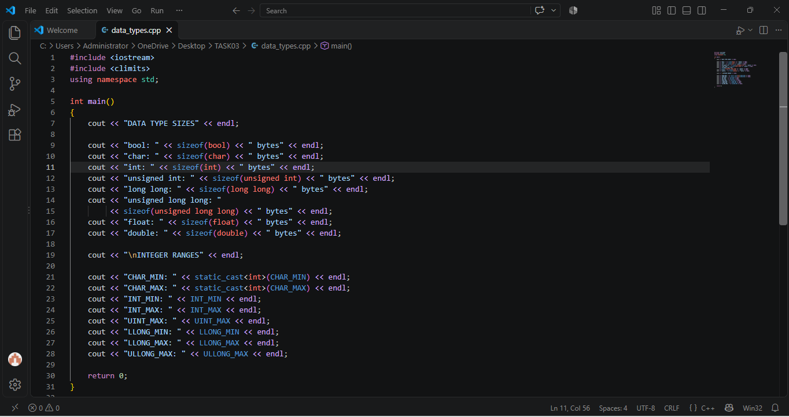
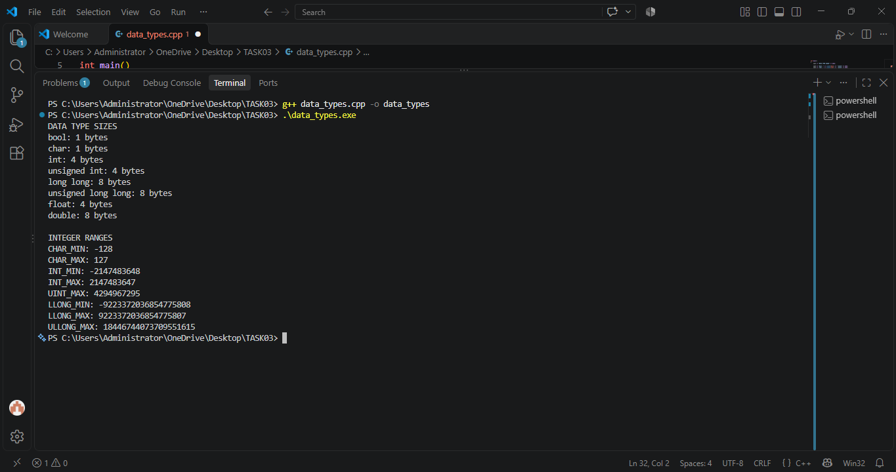
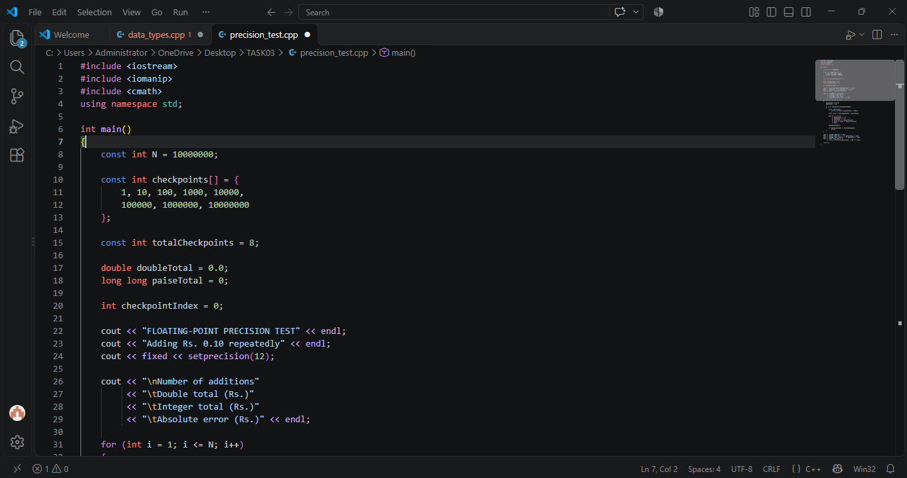
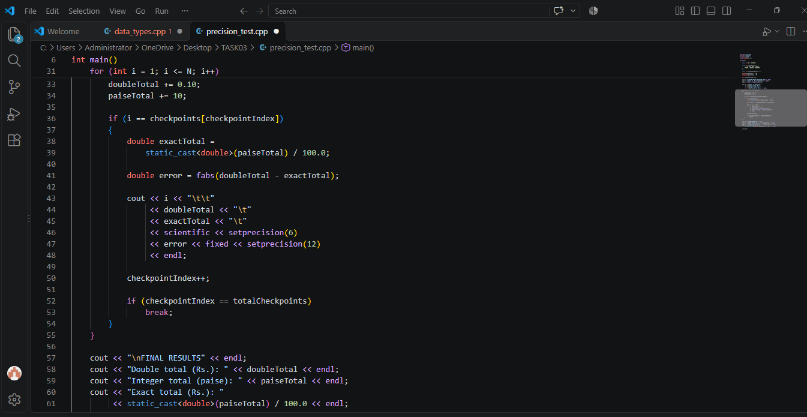
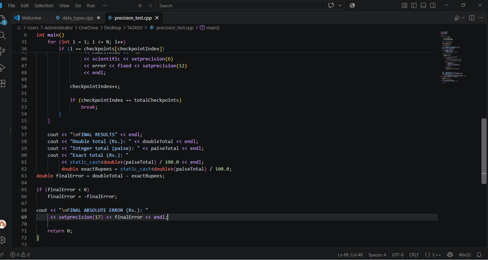
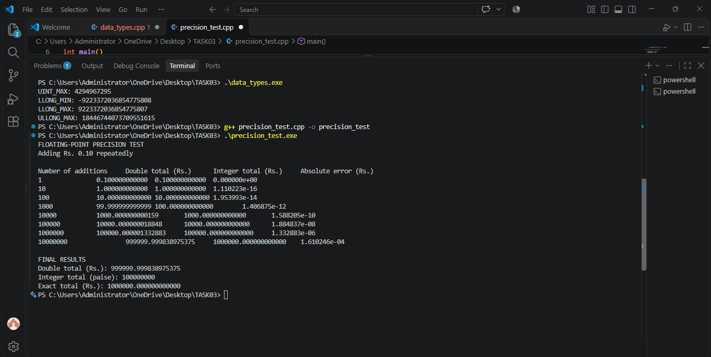

# TASK 03 – Choose Data Types and Check Type Compatibility

## 1. Introduction

Selecting suitable data types is essential for the accuracy, reliability and memory efficiency of the metro smart-card fare system. The system must store fares, card balances, journey times, zone numbers and journey counts. An unsuitable data type can cause precision loss, integer overflow or incorrect calculations.

The data types are selected based on the nature of each value, its expected range and the operations performed on it.

## 2. Selection and Justification of Data Types

| System Value | Selected Data Type | Justification |
|---|---|---|
| Fare amount | `long long` | Stores monetary values as integer paise without floating-point rounding errors. |
| Smart-card balance | `long long` | Supports accurate additions and deductions and provides a large range. |
| Peak-hour status | `bool` | Represents whether a journey occurs during peak hours (`true` or `false`). |
| Passenger category | `enum class` | Represents named categories such as Regular, Student and Senior Citizen safely. |
| Journey hour and minute | `int` | Suitable for storing whole-number time components. |
| Zone number | `enum class` | Represents named zones clearly and prevents accidental mixing with unrelated integers. |
| Journey count | `unsigned long long` | Represents large non-negative journey counts. |
| Concession percentage | `int` | Stores a whole-number percentage. |
| Approximate calculations | `float` | Suitable for calculations where lower floating-point precision is acceptable; not recommended for fare storage. |
| Display and measurement calculations | `double` | Provides greater floating-point precision than `float`. |
| Automatically deduced values | `auto` | Allows the compiler to determine the variable type from its initial value. |

**Note:** `auto` is a type-deduction keyword, not a separate fundamental data type. For example:

```cpp
auto baseFare = 1000LL;
```

The compiler deduces `baseFare` as `long long`.

For passenger categories and zones, `enum class` is preferable to arbitrary numerical or character codes because it provides clearer and type-safe representation.

## 3. Data Type Sizes and Integer Ranges

The `sizeof` operator determines the memory occupied by a data type on the system. The `<climits>` header provides the minimum and maximum limits of integer types.

The following program measures the sizes and ranges using the actual compiler.

### Program: data_types.cpp

```cpp
#include <iostream>
#include <climits>
using namespace std;

int main()
{
    cout << "DATA TYPE SIZES" << endl;

    cout << "bool: " << sizeof(bool) << " bytes" << endl;
    cout << "char: " << sizeof(char) << " bytes" << endl;
    cout << "int: " << sizeof(int) << " bytes" << endl;
    cout << "unsigned int: " << sizeof(unsigned int) << " bytes" << endl;
    cout << "long long: " << sizeof(long long) << " bytes" << endl;
    cout << "unsigned long long: "
         << sizeof(unsigned long long) << " bytes" << endl;
    cout << "float: " << sizeof(float) << " bytes" << endl;
    cout << "double: " << sizeof(double) << " bytes" << endl;

    cout << "\nINTEGER RANGES" << endl;

    cout << "CHAR_MIN: " << static_cast<int>(CHAR_MIN) << endl;
    cout << "CHAR_MAX: " << static_cast<int>(CHAR_MAX) << endl;
    cout << "INT_MIN: " << INT_MIN << endl;
    cout << "INT_MAX: " << INT_MAX << endl;
    cout << "UINT_MAX: " << UINT_MAX << endl;
    cout << "LLONG_MIN: " << LLONG_MIN << endl;
    cout << "LLONG_MAX: " << LLONG_MAX << endl;
    cout << "ULLONG_MAX: " << ULLONG_MAX << endl;

    return 0;
}
```

### 3.1 Typical Sizes and Ranges

The following are common values on modern systems. Actual results must be verified using the program above.

| Data Type | Typical Size | Typical Range or Precision |
|---|---:|---|
| `bool` | 1 byte | `false` or `true` |
| `char` | 1 byte | Usually -128 to 127, or 0 to 255 depending on signedness |
| `int` | 4 bytes | -2,147,483,648 to 2,147,483,647 |
| `unsigned int` | 4 bytes | 0 to 4,294,967,295 |
| `long long` | 8 bytes | -9,223,372,036,854,775,808 to 9,223,372,036,854,775,807 |
| `unsigned long long` | 8 bytes | 0 to 18,446,744,073,709,551,615 |
| `float` | 4 bytes | Approximately 6–7 significant decimal digits |
| `double` | 8 bytes | Approximately 15–16 significant decimal digits |

The sizes shown are typical implementation values, not universal guarantees. The actual program output is the evidence for the system used.

### 3.2 Actual Compiler Results

The program was successfully compiled and executed using GCC 16.2.0 on Windows.

The observed results were:

| Data Type | Measured Size |
|---|---:|
| `bool` | 1 byte |
| `char` | 1 byte |
| `int` | 4 bytes |
| `unsigned int` | 4 bytes |
| `long long` | 8 bytes |
| `unsigned long long` | 8 bytes |
| `float` | 4 bytes |
| `double` | 8 bytes |

The observed integer limits were:

| Constant | Measured Value |
|---|---:|
| `CHAR_MIN` | -128 |
| `CHAR_MAX` | 127 |
| `INT_MIN` | -2147483648 |
| `INT_MAX` | 2147483647 |
| `UINT_MAX` | 4294967295 |
| `LLONG_MIN` | -9223372036854775808 |
| `LLONG_MAX` | 9223372036854775807 |
| `ULLONG_MAX` | 18446744073709551615 |

### Evidence 1 – Data Type Sizes and Ranges

**Source code:** `evidence/data_types-code.png`



**Execution output:** `evidence/sizeof-output.png`



## 4. Why Money Should Be Stored in Integer Paise Instead of Double Rupees

Money should be represented using integer paise rather than `double` rupees because floating-point numbers cannot represent every decimal fraction exactly in binary.

For example, a value such as Rs. 0.10 may be stored as a nearby binary approximation. Repeated additions can therefore introduce small rounding errors.

Storing money as integer paise avoids this problem for whole-paise transactions.

Examples:

- Rs. 10 = 1,000 paise
- Rs. 20 = 2,000 paise
- Rs. 30 = 3,000 paise
- Rs. 36 = 3,600 paise

Advantages of integer-paise representation:

1. Monetary values are stored as exact whole numbers of paise.
2. Addition and subtraction do not introduce floating-point rounding errors.
3. Fare deductions and balance updates remain accurate, provided the integer type does not overflow.
4. `long long` supports large monetary totals.

Therefore, `long long` is selected for fare and balance values stored in paise.

## 5. Type Compatibility Rules in C++

C++ allows different data types to participate in the same expression through implicit type conversions and promotions.

### 5.1 Integer and Double Conversion

When an `int` and a `double` are used in an arithmetic expression, the integer is converted to `double` before the operation.

Example:

```cpp
int a = 10;
double b = 2.5;

double result = a + b;
```

The integer value 10 is converted to 10.0, and the result is 12.5.

### 5.2 Integer Division

When two integers are divided, C++ performs integer division. The fractional part is discarded.

Example:

```cpp
int a = 7;
int b = 2;

double result = a / b;
```

The result is 3.0, not 3.5, because the division is performed using integer operands before the result is assigned to `double`.

To obtain the fractional result, an explicit conversion is required:

```cpp
double result = static_cast<double>(a) / b;
```

The result is 3.5.

### 5.3 Integer and Boolean Conversion

When an integer is converted to `bool`:

- Zero becomes `false`.
- Any non-zero value becomes `true`.

Example:

```cpp
int balance = 100;
bool hasBalance = balance;
```

Here, `hasBalance` becomes `true`.

When a Boolean value is printed normally, it appears as 1 for `true` and 0 for `false`. Using `boolalpha` displays the words `true` and `false`.

These conversion rules must be considered carefully to prevent unexpected results in fare calculations and balance validation.

### 5.4 Mixed Expression Using int, double and bool

The following example demonstrates how C++ handles all three data types in one arithmetic expression.

```cpp
int journeys = 2;
double fare = 10.5;
bool peakHour = true;

double total = journeys + fare + peakHour;

cout << total << endl;
```

**Output:**
```text
13.5
```

**Explanation:** The Boolean value `true` is promoted to integer value `1`. The integer operands are then converted to `double` during the arithmetic operation. Therefore, the result is 2 + 10.5 + 1 = 13.5.

## 6. Integer Ranges and Daily Collection Analysis

The `<climits>` header provides the limits of integer data types.

For the 32-bit signed `int` used by the compiler:

- `INT_MIN` = -2,147,483,648
- `INT_MAX` = 2,147,483,647

The metro network is expected to grow to 3,000,000 journeys per day.

The maximum base fare is Rs. 30. During peak hours, a 20% surcharge applies.

Maximum fare before concessions:

Rs. 30 + 20% of Rs. 30 = Rs. 36

Maximum daily collection:

3,000,000 × Rs. 36 = Rs. 108,000,000

Converting this amount into paise:

Rs. 108,000,000 × 100 = 10,800,000,000 paise

This exceeds the maximum value of a 32-bit signed integer, which is 2,147,483,647.

Therefore, `int` is insufficient to store the maximum possible daily collection in paise. Using `long long` resolves this overflow problem because it supports a much larger range.

This calculation assumes every journey pays the maximum peak fare and does not receive a concession. It is therefore a conservative upper-bound capacity calculation.

## 7. Alternative Concept: Double Rupees vs Long Long Paise

An alternative solution is to store monetary values using `double` in rupees instead of `long long` in paise.

| Parameter | `double` in Rupees | `long long` in Paise |
|---|---|---|
| Representation | Floating-point | Integer |
| Typical memory per value | 8 bytes | 8 bytes |
| Time per addition | O(1) | O(1) |
| Space per value | O(1) | O(1) |
| Monetary precision | Approximate | Exact for whole-paise values |
| Rounding error | Possible | No floating-point rounding error |

Both methods have constant-time addition, O(1), and typically use 8 bytes per value on the tested system.

However, `double` uses approximate binary floating-point representation. Repeated additions can accumulate rounding differences.

The integer-paise approach avoids this problem for transactions expressed in whole paise and is therefore more appropriate for a fare collection system.

## 8. Measuring Floating-Point Rounding Error

The following program compares repeated addition using `double` with integer-paise addition. It measures the difference after increasing numbers of additions.

### Program: precision_test.cpp

```cpp
#include <iostream>
#include <iomanip>
#include <cmath>
using namespace std;

int main()
{
    const int N = 10000000;

    const int checkpoints[] = {
        1, 10, 100, 1000, 10000,
        100000, 1000000, 10000000
    };

    const int totalCheckpoints = 8;

    double doubleTotal = 0.0;
    long long paiseTotal = 0;

    int checkpointIndex = 0;

    cout << "FLOATING-POINT PRECISION TEST" << endl;
    cout << "Adding Rs. 0.10 repeatedly" << endl;

    cout << fixed << setprecision(12);

    cout << "\nNumber of additions"
         << "\tDouble total (Rs.)"
         << "\tInteger total (Rs.)"
         << "\tAbsolute error (Rs.)" << endl;

    for (int i = 1; i <= N; i++)
    {
        doubleTotal += 0.10;
        paiseTotal += 10;

        if (i == checkpoints[checkpointIndex])
        {
            double exactTotal =
                static_cast<double>(paiseTotal) / 100.0;

            double error = fabs(doubleTotal - exactTotal);

            cout << i << "\t\t"
                 << doubleTotal << "\t"
                 << exactTotal << "\t"
                 << scientific << setprecision(6)
                 << error << fixed << setprecision(12)
                 << endl;

            checkpointIndex++;

            if (checkpointIndex == totalCheckpoints)
                break;
        }
    }

    cout << "\nFINAL RESULTS" << endl;
    cout << "Double total (Rs.): " << doubleTotal << endl;
    cout << "Integer total (paise): " << paiseTotal << endl;
    cout << "Exact total (Rs.): "
         << static_cast<double>(paiseTotal) / 100.0 << endl;

    return 0;
}
```

### 8.1 Explanation of the Experiment

The program adds Rs. 0.10 repeatedly using two methods:

- `doubleTotal` stores the accumulated amount as a floating-point value.
- `paiseTotal` stores each transaction as 10 integer paise.

The expected exact total is calculated from the integer-paise value. At each checkpoint, the absolute difference between the two totals is measured.

The actual measured errors are recorded from the compiler output. Floating-point error does not necessarily increase monotonically at every checkpoint, so measured values should be reported rather than assumed.

### 8.2 Actual Experimental Results

The program was successfully compiled and executed using GCC 16.2.0 on Windows.

A total of 10,000,000 additions of Rs. 0.10 were performed using both methods.

The final observed results were:

| Measurement | Actual Result |
|---|---:|
| Number of additions | 10,000,000 |
| Double total | Rs. 999,999.9998383975375 |
| Integer total | 100,000,000 paise |
| Exact total | Rs. 1,000,000.0000000000000 |
| Absolute rounding error | Rs. 0.00016102462541312 |

The measured absolute errors at the intermediate checkpoints were:

| Number of Additions | Measured Absolute Error (Rs.) |
|---:|---:|
| 1 | 0 |
| 10 | 1.110223 × 10⁻¹⁶ |
| 100 | 1.953993 × 10⁻¹⁴ |
| 1,000 | 1.406875 × 10⁻¹² |
| 10,000 | 1.588205 × 10⁻¹⁰ |
| 100,000 | 1.884837 × 10⁻⁸ |
| 1,000,000 | 1.332883 × 10⁻⁶ |
| 10,000,000 | 1.610246 × 10⁻⁴ |

The experiment demonstrates that repeated floating-point addition can accumulate measurable rounding error. In contrast, integer-paise addition produces the exact total for this test.

The absolute error generally increases as additions accumulate, although it need not increase monotonically at every checkpoint.

### Evidence 2 – Precision Comparison

**Source code screenshots:**

- `evidence/precision-test-code1.png`
- `evidence/precision-test-code2.png`
- `evidence/precision-test-code3.png`

**Execution output:** `evidence/precision-output.png`







**Execution output:** `evidence/precision-output.png`



## 9. Conclusion

Appropriate data type selection is essential for the accuracy and reliability of the metro smart-card fare system. `long long` is suitable for storing monetary values in integer paise because it avoids floating-point rounding errors and provides sufficient range for large collections.

The `sizeof` operator and `<climits>` header help verify memory requirements and integer limits on the actual system. Type compatibility rules explain how C++ handles mixed expressions involving integers, floating-point values and Boolean values.

The daily collection calculation demonstrates that a 32-bit `int` is insufficient for the maximum network collection in paise. The precision experiment further demonstrates why integer-based monetary calculations are preferable to floating-point storage.
